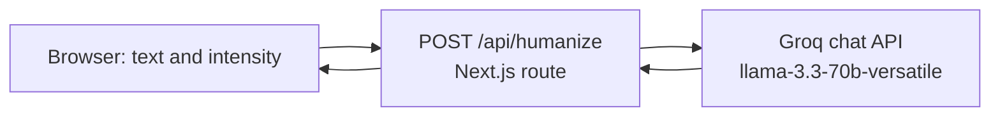

# HumanizeAI

A small web app that rewrites stiff, AI-sounding text in a more casual, human voice, with three intensity levels.

**Status:** working prototype · small, single-purpose · live demo: <https://humanizeai-peach.vercel.app>

## Overview

Paste text, pick an intensity (light, medium or heavy), and get a rewrite. The app counts words on both sides and has a copy button. It is one page and one API route.

**Intended user:** someone drafting emails, posts or notes with an AI tool who wants the result to read less formal.

## How it works



The route picks a system prompt for the chosen intensity and sends it, with the user's text, to Groq's OpenAI-compatible chat endpoint. The API key stays on the server and is never sent to the browser.

The prompts ask the model to use contractions and everyday words, vary sentence length, and add a small number of natural-looking typos and grammar slips. The heavy mode is worded as an attempt to make text hard to identify as AI-written.

## Responsible use

There is no evidence in this repository that the output avoids any AI-detection tool, and none was tested. Do not use it to misrepresent AI-written work where disclosure is expected, such as coursework, journalism or professional submissions. Review everything it produces: deliberate typos and rewording can change meaning.

## Tech stack

Next.js 14 (App Router), React 18, a Groq-hosted Llama 3.3 70B model, deployed on Vercel.

## Run it locally

Requires Node.js 18 or newer and a [Groq API key](https://console.groq.com).

```bash
npm install
cp .env.example .env.local     # Windows: Copy-Item .env.example .env.local
# edit .env.local and set GROQ_API_KEY
npm run dev
```

Open http://localhost:3000.

### Configuration

| Variable | Meaning |
|---|---|
| `GROQ_API_KEY` | Your Groq API key. Keep it in `.env.local`, which is git-ignored. Never commit a real key |

## Deploy to Vercel

Import the repository in Vercel, add `GROQ_API_KEY` under *Environment Variables*, and deploy.

## Limitations and next steps

- No tests, no rate limiting and no input length limit beyond the model's `max_tokens` setting, so a public deployment could be abused or run up API costs.
- Quality is not measured. There is no comparison of the output against the input for meaning drift.
- Output is not checked for accuracy, and the typo-injection can introduce errors.
- Next: add rate limiting and an input cap, and evaluate how well meaning is preserved.
